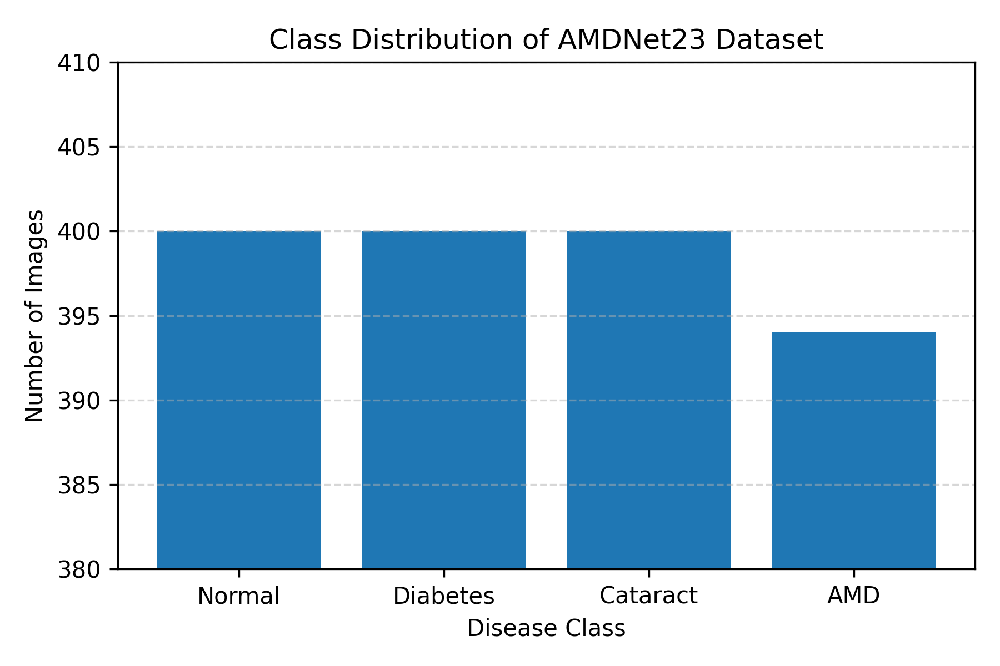
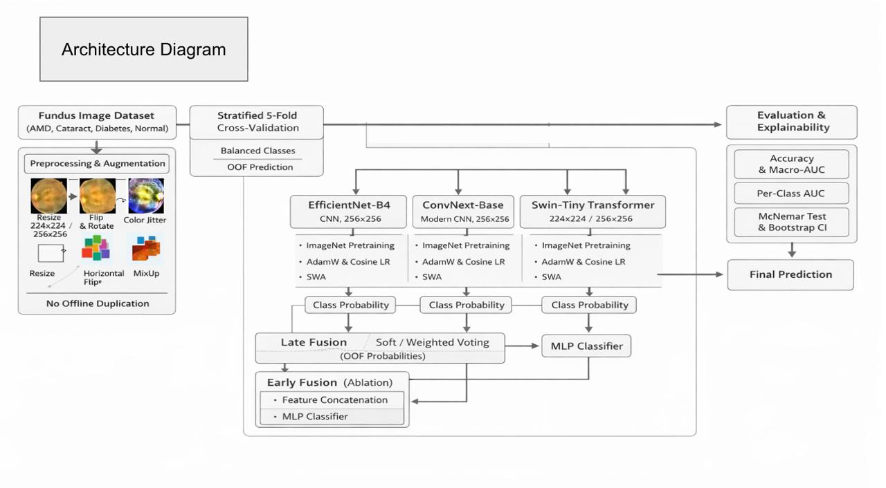
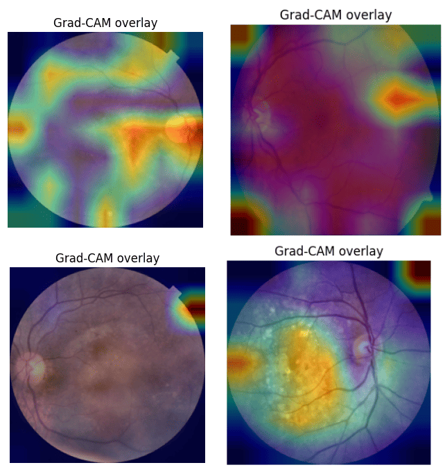
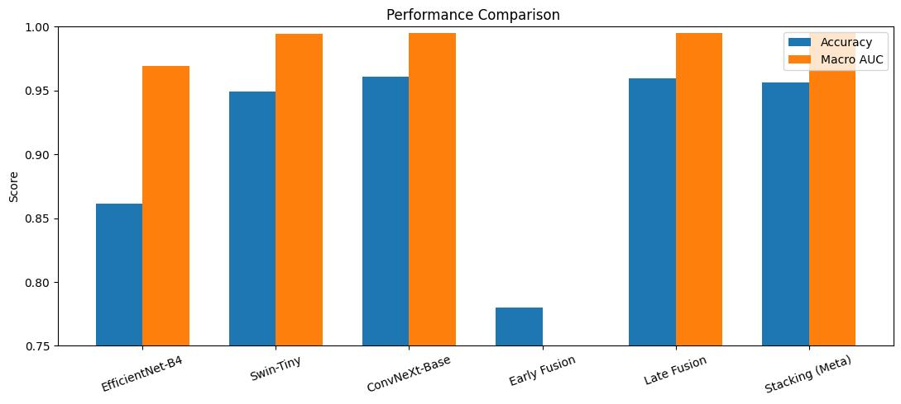
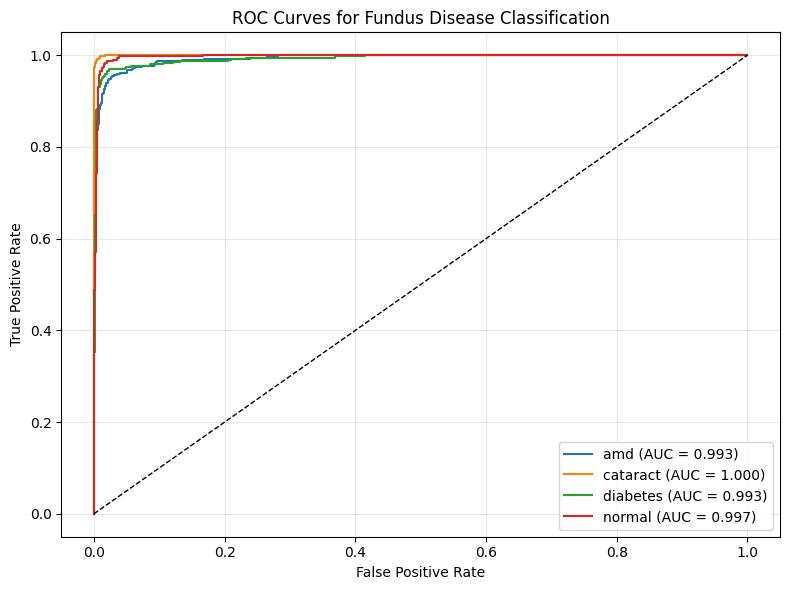
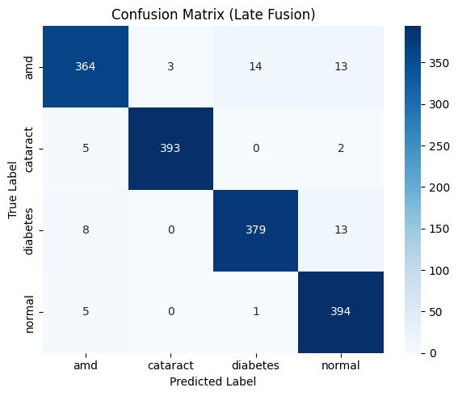

# Deep Learning-Based Fundus Image Classification for Retinal Disease Detection

## Overview

This project focuses on automated retinal disease classification from fundus images using deep learning techniques. The objective is to develop a robust classification framework capable of identifying different retinal conditions from medical images.

The project explores transfer learning approaches and ensemble learning strategies to improve classification performance and model reliability.

This work was completed as an undergraduate Machine Learning project (CSE438).

The experiments were conducted using Kaggle Notebook with GPU acceleration. The dataset was accessed through Kaggle and is not included in this repository due to size and licensing limitations.

---

## Problem Statement

Manual analysis of retinal fundus images requires expert ophthalmologists and can be time-consuming. This project investigates the use of deep learning models for automated detection and classification of retinal diseases.

The system classifies fundus images into four categories:

- Normal
- Diabetes
- Cataract
- Age-related Macular Degeneration (AMD)

---

## Dataset

The project uses a fundus image dataset containing four retinal disease categories:

- Normal
- Diabetes
- Cataract
- AMD

The dataset was processed using preprocessing and augmentation techniques to improve model generalization.

### Dataset Class Distribution

---

## Methodology

The complete workflow consists of:

1. Image preprocessing
2. Data augmentation
3. Transfer learning-based feature extraction
4. Deep learning model training
5. Ensemble learning
6. Model evaluation
7. Explainability analysis using Grad-CAM

### Model Architecture

---

## Deep Learning Models

The following architectures were implemented:

### 1. EfficientNet-B4

- CNN-based architecture
- Transfer learning using ImageNet pretrained weights

### 2. Swin Transformer

- Transformer-based vision architecture
- Captures long-range dependencies in retinal images

### 3. ConvNeXt-Base

- Modern CNN architecture
- Designed for improved feature representation

---

## Ensemble Learning Techniques

The project explored multiple fusion strategies:

- Soft Voting
- Weighted Voting
- Early Fusion
- Late Fusion
- Stacking-based Meta Classifier

---

## Explainability

Grad-CAM was applied to visualize the regions of retinal images that influenced model predictions.

This improves model interpretability and helps understand the decision-making process of deep learning models.

### Grad-CAM Visualization

---

# Experimental Results

The models were evaluated using:

- Accuracy
- AUC
- Precision
- Recall
- F1-score
- Confusion Matrix
- ROC Curve
- Cross-validation

## Performance Summary

The performance of the implemented deep learning models was evaluated using Accuracy, AUC, Precision, Recall, and F1-score.

| Model | Accuracy (%) | AUC (%) | Precision (%) | Recall (%) | F1-score (%) |
|---|---:|---:|---:|---:|---:|
| EfficientNet-B4 | 94.9 | 99.4 | 95.7 | 94.3 | 94.5 |
| Swin-Tiny | 96.1 | 99.5 | 97.1 | 96.8 | 96.5 |
| ConvNeXt-Base | 95.0 | 99.3 | 96.2 | 95.6 | 95.5 |
| Early Fusion | 78.0 | 81.4 | 80.5 | 78.4 | 79.0 |
| Stacking Ensemble | 95.7 | 99.6 | 96.5 | 95.5 | 96.0 |
| **Late Fusion** | **96.5** | **99.6** | **96.6** | 95.7 | **96.5** |

## Best Performing Model

The Late Fusion ensemble achieved the highest overall performance with:

- **Accuracy:** 96.5%
- **AUC:** 99.6%
- **Precision:** 96.6%
- **Recall:** 95.7%
- **F1-score:** 96.5%

The results demonstrate that ensemble-based approaches improve classification performance compared with individual deep learning architectures.

---

## Visual Performance Analysis

### Model Performance Comparison

### ROC Curve Analysis

### Confusion Matrix (Late Fusion)

---

## Running the Notebook

The experiments were performed in Kaggle Notebook using GPU acceleration.

To reproduce the experiments:

1. Upload the notebook to Kaggle or Jupyter environment.
2. Attach the required fundus image dataset.
3. Update the dataset path according to the environment.
4. Install dependencies from:

Note:
The dataset is not included in this repository. Users need to provide their own dataset access.

## Repository Structure
